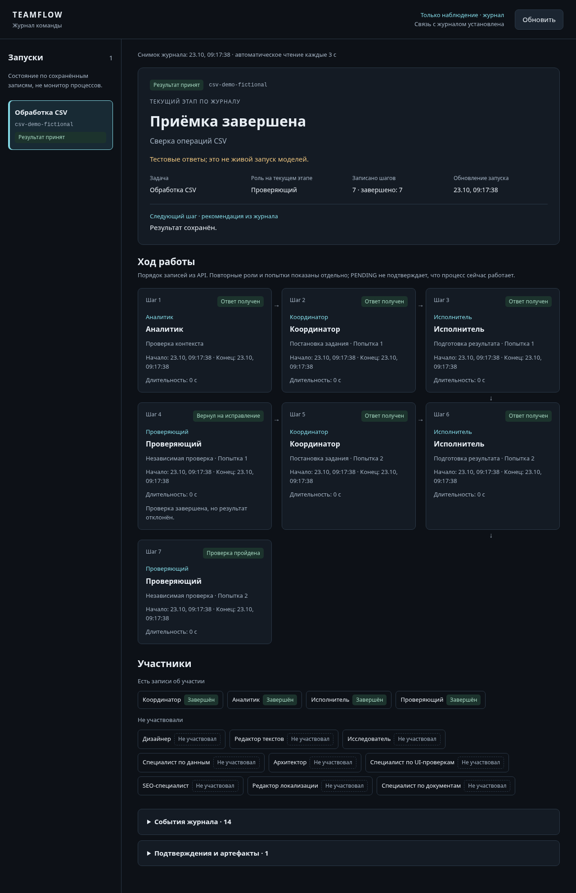
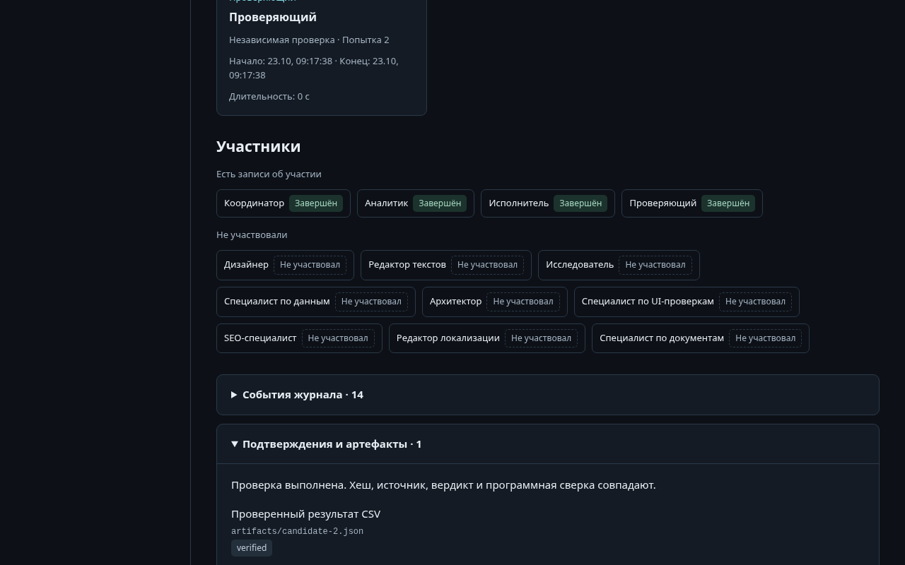

[](https://github.com/egordziuba/teamflow/actions/workflows/tests.yml)

# Teamflow — локальная команда Hermes

## Наглядная панель

Откройте **http://127.0.0.1:8769/**, пока сервер панели работает. Для повторного запуска — `Dashboard.cmd` или `python -m teamflow.dashboard --open`. Панель только читает журналы: этапы, роли, передачу задач, остановки и доказательства. Она не запускает агентов. Подробности и проверки: [docs/OBSERVER.md](docs/OBSERVER.md).




Вымышленный CSV-прогон на тестовых ответах, без вызовов модели: передача задач и подтверждение приёмки; воспроизведение — `python scripts/make_screenshots.py`.

Два ограниченных сценария, а не универсальная система разработки:

- **`pilot`** — сверка учебного CSV `examples/transactions.csv`: анализ, кандидат результата, независимая проверка и детерминированные критерии принятия. Контроллер управляет записями и нативной доской Hermes.
- **`specialists`** — общие текстовые черновики по предоставленному брифу. Координатор запрашивает только нужные дополнительные роли. Итог — **`DRAFTS_REQUIRE_REVIEW`**, а не принятый готовый продукт.

**Генерация исполняемого кода, создание готового сайта и deployment не поддерживаются.** Специалисты не выполняют браузерные проверки и не добывают внешние доказательства. Каталог ролей — доступность, а не автоматический запуск всех работников.

## Запуск

Требуются Python 3.11+ и установленный Hermes с исходниками и его Python-окружением. Выполняйте команды из каталога этого проекта. `Launch.cmd` показывает справку и ждёт нажатия клавиши; ничего не авторизует.

```console
python -m teamflow --help
python -m teamflow prepare
python -m teamflow doctor
python -m teamflow doctor --engine
python -m teamflow roles
python -m teamflow roles --project-type website
```

`prepare` создаёт управляемые профили в **`.runtime/hermes`**. Настройки чужих профилей и их credentials не копируются. Повторная подготовка не должна незаметно перезаписывать изменённую управляемую конфигурацию.

`doctor` проверяет конфигурацию и наличие isolated `auth.json`, не читает содержимое этого файла и не запрашивает модель. Наличие файла ещё не доказывает действительность credentials. `--engine` дополнительно вызывает настоящий `HermesBackend.preflight`, не модель; эта проверка требует подготовленного runtime.

### Авторизация — только вручную

До авторизации в изолированном runtime модельные запуски заблокированы. При отсутствии credentials или корректных профилей `pilot` и `specialists` возвращают JSON `error: auth_required` и код выхода 2 **до создания ledger и запроса модели**.

Когда готовы войти, самостоятельно выполните:

```console
python -m teamflow auth
```

Либо откройте **`Authenticate.cmd`**. Только этот явный запрос запускает нативный `hermes auth add openai-codex` с изолированным окружением `.runtime/hermes`; интерактивный вход может открыть браузер. Не вставляйте tokens в бриф, README или чат. Другие команды не запускают вход автоматически.

### Учебный пилот

```console
python -m teamflow pilot --run csv-demo
python -m teamflow pilot --run csv-fault --inject-fault
python -m teamflow status --run csv-demo
```

`--inject-fault` проверяет обработку намеренно испорченного кандидата; это не подмена реального ответа модели фиктивным успешным прогоном. Артефакты и ledger находятся в `runs/ИМЯ`, квитанции backend — в `runs/ИМЯ/receipts`. Повторное имя передаётся ядру для его правил возобновления; CLI не удаляет и не перезаписывает прошлый запуск самовольно.

### Специалисты по брифу

```console
python -m teamflow specialists --brief examples/website-brief.json --run website-drafts
python -m teamflow status --run website-drafts
```

Пример — полностью вымышленная мастерская интерьерных панелей: без персональных данных и реальных URLs. Формат JSON:

```json
{
  "goal": "Цель чернового анализа",
  "project_type": "website",
  "sources": [{"id": "source-1", "text": "Предоставленные исходные сведения"}],
  "acceptance": ["Критерий ручной проверки"]
}
```

Черновики требуют человеческой проверки. Пригодность роли для `website` не означает, что она будет запущена: необходим явный запрос координатора, проходящий ограничения ядра.

## Проверки всех ролей

Живые компактные проверки: `python -m teamflow.role_checks --run role-check-new`. Для выбранных ролей: `--roles designer,copywriter`. Используйте новое имя после изменения промптов или политики времени: старые запуски сохраняются и не подменяются.

Результаты и диагностированная причина задержки дизайнера сохраняются локально в `reports/ROLE-TESTS.md` (папка `reports/` не входит в репозиторий). Проверки выявили конфликт формата у специалиста по данным (исправлен) и несогласованные пределы длинного ответа дизайнера (профиль 300 с, внешний предел по умолчанию 360 с). Длинная общая цепочка пока остановилась на копирайтере с прежними пределами 90/180 с; короткие проверки прошли у всех 13 ролей. Это не общая квалификация специалистов и не доказательство устойчивости любых больших проектов.

## Границы безопасности и модели

- Корень проекта всегда `PACKAGE_ROOT`, не текущий рабочий каталог и не параметр пользователя.
- Имя запуска: `^[a-z0-9][a-z0-9-]{0,63}$`; traversal, абсолютные пути и перенаправленные каталоги отклоняются.
- Модель по умолчанию — `gpt-6-astra`. Глобальный флаг ставится **перед командой**: `python -m teamflow --model MODEL doctor`. Модель должна совпадать с подготовленными профилями; CLI не подменяет настройки молча.
- `status` строго read-only: не создаёт каталоги, не открывает ledger на запись. Его `recorded_status` — только сохранённая метка; **`verified: false` всегда означает, что CLI не подтвердил хеш артефакта, снимок источника и отсутствие pending-запросов**. Это не доказательство принятия результата.
- Ошибки runtime выдаются без сырого текста провайдера, чтобы не утекли секреты. Код 0 у `doctor` означает, что отчёт получен; смотрите `profiles_ok` и `auth_present` внутри него.

## Проверки и реальный статус

```console
python -m pytest tests/test_cli.py -q
python -m pytest tests/ -q
```

CLI проверяется через subprocess в временной копии проекта. Для проверок диспетчеризации native auth/backend заменены тестовыми границами; настоящие OAuth и модели в этих тестах не вызываются. Использован цикл TDD: тест → наблюдаемое падение → минимальная реализация → зелёный прогон.

На 2026-10-23, `python -m pytest -q`: 143 пройдено с Hermes; 126 пройдено, 17 пропущено без Hermes (в обоих случаях установлен Playwright Chromium). `node --test tests/*.cjs`: 2 пройдено для модели интерфейса панели. Интеграционные тесты нативной доски требуют локального Hermes; браузерный тест — Playwright.

Прохождение unit-тестов само по себе не доказывает live-вызов. Живые проверки теперь подтверждены отдельными receipts; результаты всех ролей и оставшиеся ограничения длинной цепочки описаны в `reports/ROLE-TESTS.md` и `STATE.md`. Повторная авторизация нужна только при отсутствии или истечении изолированного входа.
